# Resumen y guía de lectura {#resumen}

## Resumen

Este proyecto simula un ecosistema de conejos, zorros y rocas sobre una matriz, con reglas deterministas, y compara tres diseños de la misma simulación en C++17: uno secuencial (D1), uno con Pthreads y bandas fijas (D2) y uno con OpenMP y bandas que siguen la carga (D3). Una página web local muestra la simulación y permite cambiar sus parámetros.

Los tres diseños producen el mismo resultado que los 7 casos de la tarea, con 1, 2, 4, 8 y 16 hilos. Los resultados principales son estos, y varios no son los que se esperaban:

- **Más hilos no siempre es más rápido.** En Windows, 1000x1000 es el único mundo donde Pthreads y OpenMP, adaptativo y estático, pasan de 4 veces el secuencial: lo logran con 16 hilos (×{{perf:win:large1000x1000:pth:16:speedup}}, ×{{perf:win:large1000x1000:omp_a:16:speedup}} y ×{{perf:win:large1000x1000:omp_s:16:speedup}}). En 20x20 todos los diseños paralelos son más lentos que el secuencial, y en 100x100 el mejor resultado es ×{{perf:win:100x100:pth:4:speedup}}.
- **Con un hilo, los motores paralelos cuestan más que el secuencial:** de {{overr:win}}. No se investigó la causa.
- **El reparto adaptativo reduce el desequilibrio en casi todas las configuraciones, con excepciones en 20x20, pero no da una ganancia clara de tiempo.** Además, los dos casos "unbal" muestran poco desequilibrio incluso con reparto estático.
- **La comparación entre OpenMP y Pthreads depende de la plataforma.** En Windows gana Pthreads; en un contenedor Linux sobre WSL2 se invierte en 200x200, y no se demostró la causa.
- **Las poblaciones oscilan, pero no con el ciclo lento esperado.** Hay una oscilación rápida con periodo `GEN_PROC`+1 y, con `GEN_PROC_FOXES`=10, una oscilación lenta débil. No se vio ningún ciclo lento fuerte a la sensibilidad del análisis, ni se demostró que lo observado sea una dinámica depredador-presa.

## Mapa de la rúbrica y del enunciado {#mapa}

El enunciado de este proyecto no incluye rúbrica. Se usa la de los micro-proyectos anteriores del curso, que es la misma en los dos, y sus preguntas.

:::table rubrica|6,6,1.4|Dónde está cada criterio de la rúbrica.
| Criterio | Sección | Página |
|---|---|---|
| Implementación de cada diseño (30) | D1: {{num:d1}}. D2: {{num:d2}}. D3: {{num:d3}}. Base común: {{num:comun}}. Comprobación: {{num:verif}} | {{page:d1}} |
| Ventajas y desventajas de cada diseño (20) | {{num:ventajas}} | {{page:ventajas}} |
| Preguntas y comparación de rendimiento, complejidad y mantenimiento (20) | Preguntas: {{num:preguntas}}, una subsección por pregunta. Comparación: {{num:comparacion}}, con los datos de {{num:rendimiento}} | {{page:preguntas}} |
| Justificación de decisiones, estructuras y funciones (10) | Subsecciones "Justificación" de {{num:d1}}, {{num:d2}} y {{num:d3}}. Reglas: {{num:decisiones}} | {{page:decisiones}} |
| Informe y video (20) | Este documento. El enlace al video está en la portada | 1 |

:::table enunciado|6.5,5.5,1.4|Dónde está cada requisito del enunciado y de las reglas de entrega del curso.
| Requisito | Sección | Página |
|---|---|---|
| Reglas de conejos, zorros, rocas, elección de celda y conflictos | {{num:reglas}} | {{page:reglas}} |
| Entrada por stdin y salida por stdout en el formato pedido | {{num:entrada}} | {{page:entrada}} |
| Versión secuencial primero, luego paralela en memoria compartida | {{num:d1}}, {{num:d2}}, {{num:d3}} | {{page:d1}} |
| Trabajadores con porción fija y sincronización con vecinos | {{num:d2}} | {{page:d2}} |
| Solución adaptativa que balancea la carga | {{num:d3}} | {{page:d3}} |
| Grilla, estadísticas, parámetros y controles de tiempo | {{num:interfaz}} | {{page:interfaz}} |
| Patrones cíclicos y efecto de los parámetros en la estabilidad | {{num:eco}} | {{page:eco}} |
| Tiempo de CPU y tiempo total | {{num:rendimiento}}, {{num:tablas}} | {{page:rendimiento}} |
| Reflexión: más hilos no siempre es más rápido | {{num:conclusion}} | {{page:conclusion}} |
| Cada diseño en una rama, repositorio público y enlaces | Portada y {{num:ramas}} | {{page:ramas}} |
| Código modular, orientado a objetos, con arreglos y `char*` | {{num:comun}} | {{page:comun}} |
| Cómo ejecutar el programa | {{num:ejecutar}} | {{page:ejecutar}} |

## Código y ramas {#ramas}

Cada diseño tiene su rama en el [repositorio](https://github.com/EstebanBautista/MP3): [diseno-1-secuencial](https://github.com/EstebanBautista/MP3/tree/diseno-1-secuencial), [diseno-2-estatico](https://github.com/EstebanBautista/MP3/tree/diseno-2-estatico) y [diseno-3-adaptativo](https://github.com/EstebanBautista/MP3/tree/diseno-3-adaptativo). Cada una conserva el código tal como quedó al terminar ese diseño, y ese código es anterior a la versión final. Después, las partes comunes se reorganizaron: por ejemplo, las pasadas por banda salieron de `engine/sim_pth.cpp` a `engine/bands.hpp` cuando apareció el diseño 3.

La rama `main` reúne los tres diseños, la interfaz, los experimentos y este informe. **Los nombres de funciones y los números de líneas de este informe se refieren a `main`.** En las ramas 1 y 2 pueden no coincidir: `carryRabbitSubphase()` no existe en `diseno-1-secuencial`, y `engine/sim_pth.cpp` tiene {{branchloc:diseno-2-estatico:engine/sim_pth.cpp}} líneas en `diseno-2-estatico`, frente a las {{loc:engine/sim_pth.cpp}} de `main`. Lo que se midió es también la versión final del motor. Entre la rama del diseño 3 y esa versión, el motor solo cambió en comentarios y en la validación de la opción `--stats-file`.

# Descripción del problema {#problema}

El mundo es una matriz de R filas y C columnas. Cada celda está vacía o tiene un conejo, un zorro o una roca. A partir de un estado inicial se calculan N_GEN generaciones con reglas fijas, sin azar: la misma entrada debe dar siempre la misma salida. La dificultad para paralelizar es que el enunciado pide que todos los animales de una especie se muevan "al mismo tiempo", y que el orden en que se procesan no afecte el resultado, aunque varios quieran ocupar la misma celda.

## Reglas de la simulación {#reglas}

:::table reglas_tabla|2,9|Reglas del enunciado. `X` es la fila, `Y` la columna y `G` la generación que se calcula, empezando en 0.
| Tema | Regla |
|---|---|
| Orden | En cada generación se mueven primero todos los conejos y después todos los zorros. |
| Celda elegida | Se numeran desde 0, en orden norte, este, sur y oeste, las P celdas posibles. Se elige `(G+X+Y) mod P`. |
| Conejos | Pasan a una celda vacía adyacente. Sin celda vacía, se quedan. |
| Zorros | Comen un conejo adyacente si lo hay. Si no, se mueven a una celda vacía. Si tampoco hay, se quedan. |
| Procreación | Con edad de procreación de al menos `GEN_PROC_RABBITS` o `GEN_PROC_FOXES`, un animal que se mueve deja una cría en su celda, y ambos quedan con edad 0. |
| Hambre | Un zorro muere si pasan `GEN_FOOD_FOXES` generaciones sin comer. Muere tras no encontrar conejo y antes de intentar moverse. |
| Rocas | No se mueven y nadie puede ocuparlas. |
| Conflicto | Sobrevive el animal con mayor edad de procreación. Entre zorros empatados, el menos hambriento. |

## Decisiones donde el enunciado no decide {#decisiones}

El enunciado deja algunos puntos abiertos. Para cerrarlos se usaron los archivos `allgen` de los ejemplos, que muestran cada generación. Se compilaron variantes de las reglas y se compararon con ellos. Esas compilaciones de prueba no están en el repositorio; sus resultados están en `experiments/results/rule_decisions.csv`.

:::table variantes|3,1.7,1.8,2.3,2.3,1.5|Variantes de las reglas comparadas con los archivos de ejemplo.
{{table:rules}}

- **Conflicto entre conejos, decidido por los datos.** Se compara la edad después del reinicio por procreación, de modo que un conejo que acaba de procrear llega con edad 0 y pierde. Comparar antes del reinicio falla en `allgen20x20` y `allgen100x100`. Los dos órdenes discrepan en {{dec:rabbit_20x20:disagreements}} de {{dec:rabbit_20x20:conflicts}} conflictos de conejos en 20x20, y en {{dec:rabbit_100x100:disagreements}} de {{dec:rabbit_100x100:conflicts}} en 100x100.
- **Conflicto entre zorros, decisión de diseño.** Ni el enunciado ni los 7 casos deciden este punto. En ningún conflicto de zorros de los 7 casos cambia el ganador según se compare antes o después del reinicio (en 200x200 hay {{dec:fox_200x200:conflicts}} conflictos y {{dec:fox_200x200:disagreements}} discrepancias). Se usó la misma regla que en los conejos, por coherencia. Un caso no incluido en los ejemplos podría distinguir las dos opciones, y el cambio sería pequeño, pero no inmediato: `updateProcreation()` reinicia la edad antes de la entrega y `mergeFox()` solo recibe una `Cell`, así que habría que llevar la edad anterior hasta la entrega.
- **Hambre antes o después de comer: no cambia el resultado.** Los zorros que llegan a una misma celda vieron esa misma celda, así que o comieron todos o no comió ninguno. Si comieron todos, los que empatan en edad quedan idénticos. Si ninguno comió, sumar 1 a cada uno conserva el orden.
- **Las edades no tienen tope.** Un animal encerrado sigue envejeciendo por encima de `GEN_PROC`. Lo muestran los archivos: poner un tope falla en `allgen20x20` y `allgen100x100`, aunque no cambia las salidas finales, porque el animal se reinicia al moverse y nunca llega a un conflicto con esa edad.
- **Un animal por encima del límite procrea en su primer movimiento,** porque la condición es edad >= `GEN_PROC`. Una cría tiene ambas edades en 0, también si su padre no comió.

## Entrada y salida {#entrada}

El programa lee de stdin una línea con `GEN_PROC_RABBITS`, `GEN_PROC_FOXES`, `GEN_FOOD_FOXES`, `N_GEN`, `R`, `C` y `N`, seguida de N líneas `OBJETO X Y`, y escribe el estado final en stdout con el mismo formato. Las medidas de tiempo van a stderr, de modo que no alteran la salida. La lectura y la escritura quedan fuera del tiempo medido.

# Base común de los tres diseños {#comun}

Los tres diseños comparten el modelo, las reglas y el programa principal. Solo cambia la clase que recorre el mundo. Por eso una diferencia de resultados solo podría venir del reparto o de la sincronización, y una diferencia de tiempo no viene de reglas distintas.

:::table archivos|3,8|Organización del motor.
| Archivo | Contenido |
|---|---|
| `engine/world.hpp` | `Cell`, `Config` y `World`: las dos grillas en arreglos planos |
| `engine/rules.hpp` | Reglas de un animal, independientes de los hilos: `chooseNeighbor()`, `decideRabbit()`, `decideFox()`, `mergeRabbit()`, `mergeFox()` |
| `engine/simulator.hpp` | Interfaces `Simulator` y `Observer`, y las tres clases de simulador |
| `engine/cli.cpp` | `engineMain()`: opciones, lectura, cronómetro, escritura y línea de tiempos |
| `engine/io.cpp` | `readWorld()` y `writeWorld()`, con `FILE*` y `char*` |
| `engine/sim_seq.cpp` | Diseño 1 |
| `engine/bands.hpp` | Bandas, buzones y pasadas, usados por los diseños 2 y 3 |
| `engine/sim_pth.cpp` | Diseño 2 |
| `engine/sim_omp.cpp` | Diseño 3 y su control estático |

Cada ejecutable tiene un `main` mínimo: crea su simulador y llama a `engineMain()`. El nuevo diseño hereda de `Simulator`, y las opciones, los formatos y la medición de tiempo siguen siendo los mismos. Siguiendo la recomendación del curso, el motor usa arreglos en lugar de `vector` y `char*` en lugar de `string`.

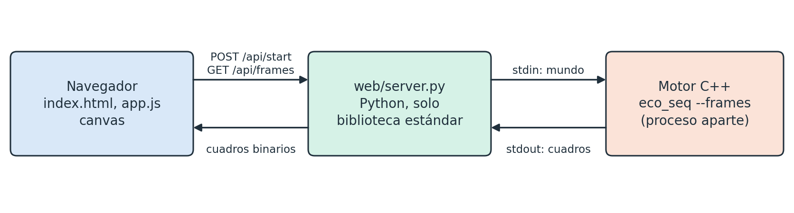

## Por qué el resultado no depende del orden {#orden}

Esta es la decisión central de todo el proyecto, y hace posibles los diseños paralelos:

1. **Una generación tiene dos subfases, conejos y zorros.** Cada una lee un estado que nadie escribe y construye uno nuevo ({{fig:fig_subfases}}). Las celdas que se liberan durante una subfase no cuentan como vacías.
2. **La decisión no escribe en nada compartido.** `decideRabbit()` y `decideFox()` reciben el estado de lectura y devuelven un `Move`, con el destino, el animal con sus edades ya actualizadas y si deja una cría.
3. **La entrega es conmutativa.** `mergeRabbit()` y `mergeFox()` conservan al mejor candidato de una celda. Los animales de una especie tienen un orden total por sus edades, y dos candidatos empatados son idénticos, así que el resultado no depende del orden de llegada. Un zorro siempre reemplaza a un conejo, se entregue primero uno u otro.

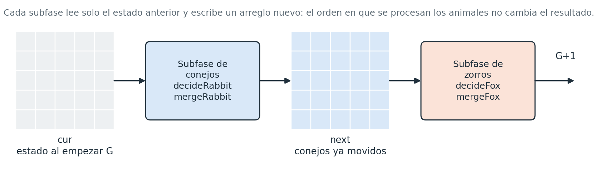

La celda de una cría es la que dejó su padre. Ningún otro animal puede elegirla en esa subfase, porque el estado de lectura la muestra ocupada.

# Implementación de cada diseño {#implementacion}

## Diseño 1: secuencial {#d1}

**Arquitectura.** Un solo hilo, que es la referencia de todos los demás. `SeqSimulator::run()` llama, para cada generación, a `rabbitSubphase()` y `foxSubphase()`. Cada subfase limpia la grilla de destino, recorre todas las celdas e intercambia las grillas al terminar ({{fig:fig_subfases}}).

**Estructuras de datos.** `World` tiene dos arreglos contiguos de `Cell`, `cur` y `next`, en orden de fila; `World::at` calcula el índice. `Cell` tiene el tipo en 1 byte y dos edades de 32 bits, 12 bytes en total con el relleno. Las dos grillas ocupan entonces 24 bytes por celda.

**Funciones principales.**

- `rabbitSubphase()` y `foxSubphase()`: recorrido del mundo.
- `decideRabbit()` y `decideFox()`: aplican las reglas a un animal.
- `applyRabbitMove()` y `applyFoxMove()`: entregan el resultado con la regla de conflicto.
- `carryRabbitSubphase()` y `carryFoxSubphase()`: copian lo que no actúa en la subfase. Un conejo que sobrevive a la subfase de zorros pasa por `mergeRabbit()`, de modo que nunca sobrescribe al zorro que lo comió.
- `clearGrid()`: limpia la grilla de destino.

**Sincronización.** Ninguna, porque hay un solo hilo.

**Justificación.** El enunciado pide empezar por una versión secuencial, y esta sirve de referencia exacta. Usa el doble búfer aunque no le haría falta para evitar carreras, porque es lo que hace que los animales se muevan "al mismo tiempo". Los arreglos planos dan acceso directo y recorrido contiguo en memoria, y el tamaño del mundo solo se conoce al leer la entrada. Se recorre toda la grilla en orden de fila, sin una lista de animales, porque es lo más simple y el resultado no depende del orden.

## Diseño 2: estático con Pthreads {#d2}

**Arquitectura.** La grilla se divide en bandas horizontales contiguas, una por hilo, con tamaños que difieren como mucho en una fila (`staticBands()`). Los hilos son persistentes: se crean una vez en `PthSimulator::run()`, y el hilo que llama actúa como trabajador 0. Las bandas no cambian durante la corrida ({{fig:fig_bandas}}).

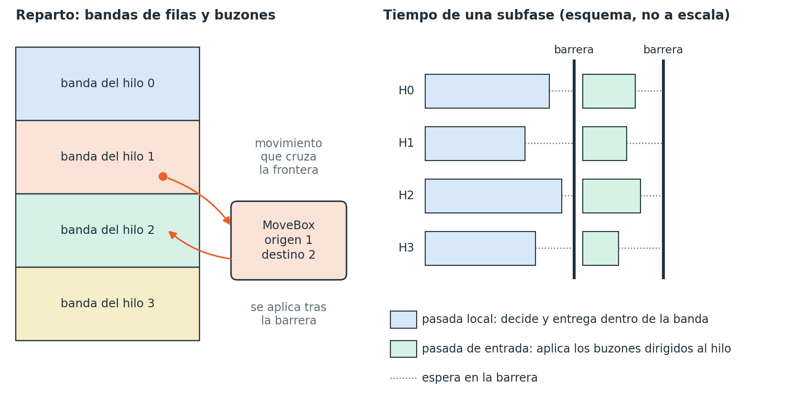

Cada subfase tiene dos pasadas separadas por barreras:

1. **Pasada local** (`rabbitLocalPass()`, `foxLocalPass()`). Cada hilo limpia su banda en la grilla de destino y recorre su banda en la de origen. Un candidato cuyo destino está en su banda se aplica directamente; si no, va a un buzón.
2. **Barrera.** Todos los buzones están completos.
3. **Pasada de entrada** (`inboundPass<mergeRabbit>()`, `inboundPass<mergeFox>()`). Cada hilo aplica los buzones dirigidos a él y los vacía.
4. **Barrera.** La grilla de destino está completa y puede leerse.

Sin observador activo hay entonces 4 barreras por generación. Como hacer un intercambio de `w.cur` y `w.next` sería una escritura compartida, los hilos no lo hacen: la subfase de conejos va de `cur` a `next`, y la de zorros de `next` a `cur`.

**Estructuras de datos.**

- `Band`: las filas `first` a `last-1` de un hilo.
- `MoveBox`: arreglo de candidatos que crece al llenarse, con `alignas(64)`. Hay uno por cada par origen y destino, de modo que son hilos al cuadrado.
- `rowOwner`: arreglo con el hilo dueño de cada fila.
- `BandPlan`: agrupa lo anterior para que las pasadas no dependan de la biblioteca de hilos.
- `Shared` y `Worker`: el contexto de un hilo, con la barrera `pthread_barrier_t`.

**Funciones principales.** `PthSimulator::run()` reserva, crea y une los hilos. `workerMain()` es el bucle de cada hilo. `BandSink` decide entre aplicar y guardar en buzón, con `pushMove()`. `maxOverMean()` calcula el desequilibrio, como el mayor tiempo ocupado dividido por la media; las esperas en barrera no cuentan como tiempo ocupado.

**Sincronización.** Solo `pthread_barrier_wait`. No hay ningún mutex, porque cada escritura tiene un único dueño: ninguna celda la escriben dos hilos, y ningún buzón lo usan dos hilos a la vez. La {{ref:p_carreras}} detalla cada caso.

**Justificación.**

- **Bandas horizontales.** Es la división más simple de las que propone el enunciado. Un movimiento solo puede cruzar a la banda vecina, y en orden de fila cada banda queda contigua en memoria.
- **Hilos persistentes.** Se calculan miles de generaciones, y crear hilos en cada una añadiría ese coste todas las veces. No se midió esa alternativa.
- **Buzones por hilo y sin candados.** El enunciado sugiere sincronizar al final con los trabajadores adyacentes. Una alternativa era proteger las celdas de frontera con candados, pero eso añadiría una operación a cada acceso de frontera. Con buzones, la pasada local no se sincroniza nunca. La matriz completa de buzones usa más memoria de la necesaria en bandas fijas, pero permite usar el mismo código en el diseño 3, donde el vecino cambia.
- **Barrera y no variables de condición.** Las fases son globales y todos los hilos terminan cada una antes de empezar la siguiente, que es justo lo que expresa una barrera.

## Diseño 3: adaptativo con OpenMP {#d3}

**Arquitectura.** Usa las mismas pasadas y barreras que el diseño 2, de `engine/bands.hpp`. Una región `#pragma omp parallel` es el equipo de hilos persistentes, y cada pasada termina con una `#pragma omp barrier` explícita. No se usa `omp for`, porque las bandas y los buzones no son iteraciones de un bucle.

Lo nuevo es `rebalance()`. Cada `REBALANCE_EVERY` generaciones, empezando por la generación 0:

1. Cada hilo estima con `fillRowCosts()` el coste de sus filas: `C + ANIMAL_WEIGHT` × animales de la fila.
2. Barrera. Después, el hilo 0 calcula los cortes con `adaptiveBands()` y los dueños con `fillRowOwners()`.
3. Barrera. Todos ven las bandas nuevas.

`adaptiveBands()` recorre las filas una vez: cada banda toma filas mientras eso la acerque a una parte igual de lo que queda. Así, las bandas posteriores a una fila muy cara reparten el resto sin pagar por ella. En la {{fig:fig_cortes}} se ve el efecto sobre un mundo real.


**Estructuras de datos.** Las mismas del diseño 2, más `rowCost`, un arreglo con el coste de cada fila. `Team` agrupa el contexto, y permite al hilo 0 cambiar `bands` y `rowOwner`, que las pasadas solo leen.

**Funciones principales.** `OmpSimulator::run()` prepara los datos y abre la región paralela. `simulate()` es el bucle de cada hilo. Además, `rebalance()`, `adaptiveBands()`, `fillRowCosts()` y `fillRowOwners()`. Las pasadas son las del diseño 2.

**Sincronización.** `#pragma omp barrier` tras cada pasada, dos barreras más en cada rebalanceo, y un `#pragma omp single` que hace el primer reparto cuando ya se conoce el equipo real. `omp_set_dynamic(0)` evita que el equipo cambie de tamaño, y si aun así es menor que el pedido (por ejemplo, con `OMP_THREAD_LIMIT`), las bandas se cortan para el equipo obtenido.

**Justificación.**

- **Rebalanceo entre generaciones.** En ese punto todos los buzones están vacíos y nadie usa las bandas anteriores. Cambiar las bandas solo cambia qué hilo calcula cada celda, y el nuevo dueño limpia la grilla de destino, así que el resultado no se altera.
- **Bandas contiguas, sin `schedule(dynamic)` por filas.** Con filas repartidas dinámicamente, una fila no tendría dueño conocido cuando otro hilo quisiera escribir en ella, y harían falta candados en las celdas. Conservar bandas mantiene el diseño sin candados.
- **OpenMP.** Una misma estructura se escribe con menos código de gestión de hilos, y usar los dos modelos permite comparar su coste de desarrollo y de ejecución.
- **Control estático.** Con `--schedule static` el diseño 3 usa `staticBands` y nunca rebalancea. No es un `schedule(static)` literal: como no hay `omp for`, esa cláusula no tendría dónde aplicarse, y reescribir el motor alrededor de un `omp for` cambiaría también la sincronización. Con este control, misma biblioteca, mismos buzones y mismas barreras, lo único que cambia es el reparto. Esto separa el efecto del reparto del efecto del modelo de hilos.

**Elección de las constantes.** `ANIMAL_WEIGHT` = 8 y `REBALANCE_EVERY` = 50 se eligieron midiendo los dos casos "unbal" con 8 hilos y 5 repeticiones ({{tab:constantes}}). Para el peso, el desequilibrio mejora de 4 a 16 y empeora en 1 y 64, sin un óptimo marcado. Para el periodo, el tiempo cae rápido al rebalancear menos (cada rebalanceo añade dos barreras y un recorrido de la grilla), y 50 está entre los de menor desequilibrio. El barrido varía un parámetro cada vez: no es una búsqueda completa. Se hizo antes de congelar el motor y es independiente de las mediciones de la {{ref:rendimiento}}.

:::table constantes|4,4,4|Barrido de las constantes del diseño 3 (`experiments/results/constants_sweep.csv`): mediana de 5 corridas con 8 hilos. El periodo está en generaciones.
{{table:constants}}

Incluso con los valores elegidos, el tiempo en estos dos casos no mejora frente al reparto estático. Se discute en la {{ref:adaptativo}}.

# Ventajas y desventajas de cada diseño {#ventajas}

:::table vd1|5,5|Diseño 1: secuencial.
| Ventajas | Desventajas |
|---|---|
| Es el más simple: {{loc:engine/sim_seq.cpp}} líneas propias y sin sincronización. | Usa un solo núcleo. En el mundo grande tarda {{perf:win:large1000x1000:seq:1:wall}} s, frente a {{perf:win:large1000x1000:pth:8:wall}} s con Pthreads y 8 hilos. |
| Es el más rápido en mundos pequeños: {{perf:win:20x20:seq:1:wall}} s en 20x20, y a un solo hilo supera siempre a los otros dos diseños. | Su tiempo crece con el tamaño del mundo, sin forma de compensarlo. |
| No puede tener carreras, y sirve de referencia exacta para verificar los otros. | Recorre todas las celdas aunque el mundo esté casi vacío. |
| Consume el mínimo de CPU para el mismo trabajo. | |

:::table vd2|5,5|Diseño 2: estático con Pthreads.
| Ventajas | Desventajas |
|---|---|
| Fue el más rápido en Windows en casi todos los casos: en 200x200, {{perf:win:200x200:pth:8:wall}} s frente a {{perf:win:200x200:omp_a:8:wall}} s de OpenMP con 8 hilos. | Exige gestionar a mano los hilos, la barrera y la memoria: {{loc:engine/sim_pth.cpp}} líneas, más las {{loc:engine/bands.hpp}} compartidas de `engine/bands.hpp`. |
| Sincronización explícita y fácil de seguir: 4 barreras por generación, sin candados. | Reparto fijo: si la carga se concentra en unas filas, no se adapta. En estos casos la pérdida medida es pequeña (desequilibrio de {{perf:win:100x100_unbal01:pth:8:imb}} en `unbal01` con 8 hilos). |
| Con ThreadSanitizer y gcc {{env:linux:compiler}} no se observaron carreras en las corridas indicadas ({{tsan:pth:total}} avisos). | En mundos pequeños es más lento que el secuencial, algo coherente con el coste de las barreras, aunque no demostrado: en 20x20 con 16 hilos tarda {{perf:win:20x20:pth:16:wall}} s, frente a {{perf:win:20x20:seq:1:wall}} s del secuencial. |
| Pocas dependencias: solo una biblioteca POSIX de hilos. | En 200x200 fue el peor en el contenedor Linux: {{perf:linux:200x200:pth:16:wall}} s con 16 hilos. |

:::table vd3|5,5|Diseño 3: adaptativo con OpenMP.
| Ventajas | Desventajas |
|---|---|
| Se adapta a la carga: por ejemplo, en 1000x1000 con 8 hilos baja el desequilibrio de {{perf:win:large1000x1000:omp_s:8:imb}} a {{perf:win:large1000x1000:omp_a:8:imb}}. | Esa mejora no se traduce en una ganancia clara de tiempo, y en los casos "unbal" es algo más lento que el control estático. |
| Gestión de hilos más breve: el compilador crea el equipo, y el código de hilos es solo una región paralela y sus barreras. | Es el más complejo por lógica: añade costes, cortes, dueños cambiantes y dos barreras más cada 50 generaciones. |
| Fue el mejor en 200x200 en el contenedor Linux: ×{{perf:linux:200x200:omp_a:16:speedup}} con 16 hilos, aunque con mucha variación. | En Windows es el más lento con barreras: en 100x100 con 16 hilos, {{perf:win:100x100:omp_a:16:wall}} s frente a {{perf:win:100x100:pth:16:wall}} s de Pthreads. |
| Comparte las pasadas con el diseño 2, y un mismo binario hace de control con `--schedule static`. | Comprobar carreras es más difícil: la biblioteca de gcc no está instrumentada, y hace falta otra cadena de herramientas ({{ref:tsan}}). |

# Preguntas por diseño {#preguntas}

## ¿Puede aprovechar múltiples núcleos, y por qué? {#p_nucleos}

**Diseño 1.** No. Todo el trabajo lo hace un hilo, y el tiempo de CPU es prácticamente igual al tiempo total. En 1000x1000 son {{perf:win:large1000x1000:seq:1:cpu}} s de CPU y {{perf:win:large1000x1000:seq:1:wall}} s de reloj.

**Diseño 2.** Sí, porque cada hilo calcula su banda de forma independiente y solo se coordina en las barreras. Los datos son coherentes con que aprovecharlos dependa del trabajo de cada generación frente al coste de las barreras, aunque no se demostró. En 1000x1000 con 8 hilos acelera ×{{perf:win:large1000x1000:pth:8:speedup}}, con eficiencia {{perf:win:large1000x1000:pth:8:eff}}. En 100x100 el máximo es ×{{perf:win:100x100:pth:4:speedup}} con 4 hilos, y con 16 hilos cae a ×{{perf:win:100x100:pth:16:speedup}}. Pasar de 8 a 16 hilos en este equipo significa usar núcleos lógicos (SMT), no físicos, y en 1000x1000 casi no mejora: {{perf:win:large1000x1000:pth:8:wall}} s a {{perf:win:large1000x1000:pth:16:wall}} s.

**Diseño 3.** Sí, por la misma razón, y en 1000x1000 alcanza una aceleración parecida (×{{perf:win:large1000x1000:omp_a:8:speedup}} con 8 hilos). En Windows, sin embargo, no llega a superar al secuencial en los mundos de 100x100: su máximo es ×{{perf:win:100x100:omp_s:4:speedup}} con el control estático. En el contenedor Linux la situación cambia, como se ve en la {{ref:linux}}.

## ¿Qué variables se comparten, y dónde podría haber una carrera? {#p_carreras}

**Diseño 1.** Ninguna, porque hay un solo hilo.

**Diseños 2 y 3.** Están en la {{tab:compartidas}}, con el punto donde podría ocurrir una carrera y lo que la impide. La {{ref:tsan}} indica cómo se comprobó.

:::table compartidas|2.2,4,4|Variables compartidas, posibles carreras y lo que las evita en los diseños 2 y 3.
| Variable | Dónde podría ocurrir la carrera | Qué lo evita |
|---|---|---|
| Grilla de origen | Un hilo lee una celda de otra banda (un vecino) mientras alguien la escribe. | Nadie escribe la grilla de origen durante la subfase. La barrera final de la subfase anterior ordena esas escrituras antes de estas lecturas. |
| Grilla de destino | Dos hilos escriben la misma celda de una frontera. | Cada hilo solo escribe y limpia filas de su banda. Lo que cae en otra banda va a un buzón. |
| Buzones `MoveBox` | El origen añade mientras el destino lee, o varios orígenes escriben a la vez. | Hay un buzón por par origen y destino. El origen escribe en la pasada local, y el destino lee después de la barrera. |
| Contadores contiguos de los buzones | Compartición falsa (no es una carrera, pero cuesta tiempo). | `alignas(64)` separa cada buzón en su línea de caché. |
| `bands` y `rowOwner` | D3: el hilo 0 los cambia mientras otros los leen. En D2 no cambian tras crearse los hilos. | El cambio ocurre entre las dos barreras de `rebalance()`, cuando los demás esperan. |
| `rowCost` (D3) | El hilo 0 lee los costes mientras los demás los calculan. | Cada hilo escribe solo sus filas, y el hilo 0 lee tras la barrera. |
| `busy` | Un hilo publica su tiempo mientras se calcula el desequilibrio. | Cada hilo escribe su posición al terminar, y se lee tras unir los hilos o cerrar la región paralela. |
| Observador | Se leen los datos mientras otro hilo escribe. | Lo ejecuta un solo hilo, tras la última barrera y con los demás esperando en otra. |
| `team.plan.threads` (D3) | Se lee antes de conocerse el equipo. | Se escribe dentro de `omp single`, cuya barrera implícita precede a toda lectura posterior. |

El error más sutil posible es un `rowOwner` desactualizado tras un rebalanceo: dos hilos escribirían una misma celda y la salida podría seguir siendo correcta. Por eso el resultado correcto no basta como prueba, y `tests/omp_bands_test.cpp` comprueba por separado que los dueños coinciden con las bandas.

## ¿Qué estructuras de datos se usan, y se pueden mejorar? {#p_estructuras}

**Diseño 1.** Dos arreglos planos de `Cell` y ninguna otra estructura durante la corrida. *Mejoras posibles, no probadas:* una lista de animales evitaría recorrer celdas vacías en mundos poco poblados, a cambio de mantenerla ordenada o de aceptar otro orden de entrega. Separar los tipos de las edades en dos arreglos reduciría la memoria en cada recorrido. Las edades no se pueden acortar sin cuidado, porque no tienen tope y un animal encerrado puede acumular tantas como generaciones.

**Diseño 2.** Además, `Band`, `rowOwner` y una matriz de `MoveBox`. *Mejoras posibles, no probadas:* como con bandas fijas un movimiento solo llega a una banda vecina, bastarían dos buzones por hilo y no hilos al cuadrado; se conservó la matriz para compartir el código con el diseño 3. Una división en dos dimensiones reduciría las fronteras en mundos muy grandes, pero añadiría vecinos y código.

**Diseño 3.** Además, `rowCost`. *Mejoras posibles, no probadas:* el coste es una estimación con un peso fijo, y se podría usar el tiempo real de cada banda. Rebalancear solo cuando el desequilibrio supere un umbral evitaría barreras inútiles. Dado que el desequilibrio medido ya es pequeño ({{ref:adaptativo}}), estas mejoras parecen tener poco margen. No se midió un desglose del coste por partes.

## ¿Qué tan fácil es extender el programa, y qué tan independientes son las entidades? {#p_extension}

Las entidades no son objetos ni tienen hilo propio: son celdas de un arreglo, sin identidad. Su independencia viene de las reglas: dentro de una subfase, un animal decide viendo solo el estado de lectura y nunca sabe qué decidió otro. Solo interactúan en la entrega, cuando coinciden en una celda.

**Diseño 1.** Es el más fácil de extender. Cambiar una regla se hace en `engine/rules.hpp`. Una especie nueva necesita un valor en `CellKind`, sus campos en `Cell`, una función de decisión, una de entrega y una subfase más. Agregar más animales de las especies existentes no exige ningún cambio: es solo otra línea en la entrada.

**Diseño 2.** Cambiar una regla es igual de simple, porque también está en `engine/rules.hpp`. Una especie nueva necesita además una pasada local en `engine/bands.hpp` y 2 barreras más por generación en `workerMain()`. Hay que cuidar que su regla de entrega siga siendo conmutativa, porque de eso depende el resultado.

**Diseño 3.** Igual que el diseño 2, en `simulate()`. Si la especie nueva tuviera un coste distinto, también habría que revisar `fillRowCosts()`, que hoy da el mismo peso a conejos y zorros.

Agregar un diseño completo es relativamente sencillo en los tres casos: basta una clase que herede de `Simulator` y un `main` de pocas líneas.

## ¿Qué pasa con miles de entidades, y con entradas más grandes? {#p_escala}

En ningún diseño aumenta el número de hilos al aumentar las entidades, a diferencia de un diseño con un hilo por entidad. El coste de una generación es proporcional a las celdas más los animales, y la memoria a las celdas. Una grilla de 1000x1000 ocupa 24 MB en sus dos búferes. El mundo de 1000x1000 empieza con {{env:win:rabbits}} conejos, {{env:win:foxes}} zorros y {{env:win:rocks}} rocas, y se simuló en todos los diseños con la salida verificada. No se probaron mundos mayores, ni el comportamiento cerca del límite de la memoria.

**Diseño 1.** El tiempo por generación crece con el tamaño: {{perf:win:100x100:seq:1:pergen}} µs en 100x100, {{perf:win:200x200:seq:1:pergen}} µs en 200x200 y {{perf:win:large1000x1000:seq:1:pergen}} µs en 1000x1000. No hay forma de compensarlo.

**Diseño 2.** La mejor aceleración sube con el tamaño, lo que es coherente con que haya más trabajo entre barreras, aunque no se demostró: ×{{perf:win:100x100:pth:4:speedup}} en 100x100, ×{{perf:win:200x200:pth:8:speedup}} en 200x200 y ×{{perf:win:large1000x1000:pth:16:speedup}} en 1000x1000, y también sube el número de hilos que conviene usar. Con más movimientos que cruzan bandas, los buzones crecen, y se amplían duplicando su capacidad.

**Diseño 3.** Sigue la misma tendencia: ×{{perf:win:100x100:omp_a:4:speedup}} en 100x100, ×{{perf:win:200x200:omp_a:4:speedup}} en 200x200 y ×{{perf:win:large1000x1000:omp_a:16:speedup}} en 1000x1000. Cada rebalanceo recorre la grilla, de modo que su coste también crece con el mundo. Con pocas filas por hilo pueden quedar bandas vacías; las pruebas cubren esos mundos delgados.

# Verificación de la corrección {#verif}

## Qué se comprobó {#corrida}

- **Salidas finales.** Los 3 diseños reproducen los 7 archivos `output*` de los ejemplos, con 1, 2, 4, 8 y 16 hilos en los diseños paralelos y con ambos repartos de OpenMP. La comparación es de bytes tras normalizar los finales de línea.
- **Todas las generaciones.** `eco_seq` reproduce `allgen5x5`, `allgen10x10`, `allgen20x20` y `allgen100x100`, las {{ngen:100x100}} generaciones de este último, comparadas con `tools/diff_allgen.py`, que ignora finales de línea y líneas vacías al final. La comparación de `allgen100x100` se ejecuta aparte porque el archivo no se incluye en el repositorio. Los diseños paralelos se comparan generación por generación con el secuencial en los mundos pequeños.
- **Repetición.** 20 corridas seguidas de cada diseño paralelo con 8 hilos, para detectar resultados que cambien entre ejecuciones.
- **Casos límite.** Sin animales, sin generaciones, extinción, 16 hilos en mundos muy delgados, y más hilos que filas.
- **Reglas aisladas.** `tests/rules_test.cpp` prueba que la entrega da igual en cualquier orden, y `tests/omp_bands_test.cpp` prueba que los cortes siguen la carga en las generaciones correctas.
- **En cada medición.** Cada una de las mediciones de tiempo comparó su salida con la esperada, y ninguna falló. En el mundo grande, para el cual no hay salida oficial, la referencia es la salida de `eco_seq`.
- **En Linux.** La suite del motor también se ejecutó y pasó en un contenedor `gcc:14`, cuando se congeló el motor. Las pruebas añadidas después solo se ejecutaron en Windows.

La suite tiene {{tests:}} pruebas (`python -m unittest discover -s tests -t .`), y todas pasan en Windows con la versión final.

## Condiciones de carrera: qué se ejecutó y qué no {#tsan}

ThreadSanitizer (TSan) no está disponible con MinGW, así que se usó en Linux, dentro de un contenedor Docker sobre WSL2. Los archivos con la evidencia están en `experiments/results`, y `scripts/tsan.sh` la reproduce.

:::table tsan_tabla|3.3,4,1.5,2.5|Corridas con ThreadSanitizer. Cada fila son {{tsan:pth:runs}} corridas: 20x20 ({{ngen:20x20}} generaciones) y `unbal01` (acortado a {{tsan:pth:gens}} generaciones), con 4 y 8 hilos, con `--dump-all` y sin observador.
| Motor | Compilador y biblioteca | Avisos | Salida igual a la secuencial |
|---|---|---|---|
| `eco_pth` | gcc {{env:linux:compiler}}, TSan | {{tsan:pth:total}} | {{tsan:pth:identical}} |
| `eco_omp` con Archer | {{tsan:archer:compiler}}, libomp y Archer | {{tsan:archer:total}} | {{tsan:archer:identical}} |
| `eco_omp` sin Archer | gcc {{env:linux:compiler}}, libgomp sin instrumentar | {{tsan:omp:total}} (se consideran falsos positivos, ver abajo) | {{tsan:omp:identical}} |

**Pthreads.** En estas corridas no se observaron carreras. Se usó gcc {{env:linux:compiler}}, el compilador del contenedor de medición, no el g++ {{env:win:compiler}} de Windows.

**OpenMP: la evidencia se apoya en Archer, no en la compilación con gcc.** Con gcc, TSan da {{tsan:omp:total}} avisos ({{tsan:omp:warnlist}} por corrida, en {{tsan:omp:distinct}} ubicaciones distintas y {{tsan:omp:pairs}} pares de ubicaciones). libgomp, la biblioteca de OpenMP de gcc, no está instrumentada, de modo que TSan no ve el orden que imponen sus barreras. Se examinaron así:

1. Se agruparon los avisos por pares de ubicaciones (la lista completa está en `experiments/results/tsan_omp.txt`) y se revisaron en el código: corresponden a pasadas o fases que separa una `#pragma omp barrier`, la barrera implícita de `omp single` o el final de la región paralela. Los pares de una misma línea, como dos entregas en la misma celda, son compatibles con hilos que escriben en generaciones distintas tras un rebalanceo. Esta revisión es por ubicación, no por instancia, y por eso no basta sola.
2. Se repitieron las corridas con Archer, la herramienta de LLVM que informa a TSan de las barreras de OpenMP, compilando con clang y libomp. Dieron {{tsan:archer:total}} avisos.
3. Como control negativo, un programa pequeño en el mismo entorno da {{tsan:archer:control:with_barrier}} avisos con barrera y {{tsan:archer:control:no_barrier}} sin ella, así que Archer sí detecta una barrera ausente.
4. La cobertura de código confirma que esas corridas ejecutaron el rebalanceo: `adaptiveBands()` se llamó {{tsan:archer:fnda:adaptiveBands}} veces, las esperadas.

Por eso se consideran falsos positivos, sin suprimir ninguno y sin cambiar el motor por ellos. Para OpenMP, por tanto, lo que se afirma es que en estas corridas con Archer no se observaron carreras. Clang y libomp no son la compilación con gcc y libgomp que se midió.

**Con observador y sin él.** La mitad de las corridas usa `--dump-all`, con el observador y su barrera adicional, y compara todas las generaciones con el secuencial. La otra mitad corre sin opciones, y compara la salida final: es el camino que se midió, con 4 barreras por generación más las del rebalanceo.

**Lo que no se afirma ni se probó.** TSan solo ve las carreras de las ejecuciones que observa, de modo que esto no demuestra que no existan. No se ejecutó con 2 o 16 hilos, con el control `--schedule static`, con `unbal01` completo, con los mundos 100x100, `unbal02`, 200x200 o 1000x1000, ni con `-O3` (se compiló con `-O1`). Tampoco se ejecutó en Windows. El argumento de fondo es el de la {{tab:compartidas}}: cada escritura tiene un único dueño en cada fase.

# Resultados de rendimiento {#rendimiento}

## Cómo se midió {#metodo}

- **Equipo:** {{env:win:cpu}}, {{env:win:cores}} núcleos físicos y {{env:win:threadslogical}} lógicos, {{env:win:ramgb}} GB de RAM, Windows 10 nativo.
- **Compilación:** g++ {{env:win:compiler}}, `{{env:win:flags}}`, enlazado estático.
- **Mediciones:** {{env:win:reps}} repeticiones por configuración, con orden alternado, en 6 mundos y con 1, 2, 4, 8 y 16 hilos. Se reporta la mediana y, entre corchetes, el rango intercuartil (IQR). La carga de CPU antes de empezar era de {{env:win:load}} %. Docker Desktop estaba abierto en segundo plano, sin contenedores en marcha.
- **Métricas:** tiempo total (reloj monótono), tiempo de CPU de todo el proceso, aceleración (`T_seq / T`, siempre respecto a `eco_seq`), eficiencia (aceleración / hilos) y desequilibrio (mayor tiempo ocupado / media). Sin interfaz y sin escritura de cuadros; la lectura y la escritura de archivos quedan fuera. En Windows, el tiempo de CPU tiene una resolución de unos 15,6 ms, de modo que en 20x20 no es fiable.
- **Mundo grande:** generado con semilla {{env:win:seed}}: 1000x1000, con las densidades de `input200x200`, {{env:win:ngen}} generaciones.

Las tablas completas están en la {{ref:tablas}}, y los datos crudos en `experiments/results`.

## Resultados principales {#principales}

:::table mejores|2.3,1.7,4,4.3|Mejor tiempo de cada modelo por mundo, en Windows, y su aceleración respecto a `eco_seq`.
{{table:best}}


**El tamaño del mundo decide.** En 20x20, todos los diseños con 2 o más hilos son más lentos que el secuencial: {{perf:win:20x20:pth:16:wall}} s con Pthreads y {{perf:win:20x20:omp_a:16:wall}} s con OpenMP a 16 hilos, frente a {{perf:win:20x20:seq:1:wall}} s. En 100x100 solo Pthreads gana, con un máximo de ×{{perf:win:100x100:pth:4:speedup}}. En 200x200, Pthreads llega a ×{{perf:win:200x200:pth:8:speedup}} con 8 hilos. 1000x1000 es el único mundo donde Pthreads y OpenMP, adaptativo y estático, pasan de 4 veces: ×{{perf:win:large1000x1000:pth:16:speedup}}, ×{{perf:win:large1000x1000:omp_a:16:speedup}} y ×{{perf:win:large1000x1000:omp_s:16:speedup}} con 16 hilos.

**Con 16 hilos no se gana casi nunca.** En Windows, 16 hilos son más lentos que 8 en todos los mundos, salvo en 1000x1000. Allí, Pthreads y OpenMP adaptativo empatan dentro del IQR, y el control estático mejora de {{perf:win:large1000x1000:omp_s:8:wall}} s [{{perf:win:large1000x1000:omp_s:8:iqr}}] a {{perf:win:large1000x1000:omp_s:16:wall}} s [{{perf:win:large1000x1000:omp_s:16:iqr}}]. El equipo tiene 8 núcleos físicos, y del hilo 9 al 16 son núcleos lógicos.

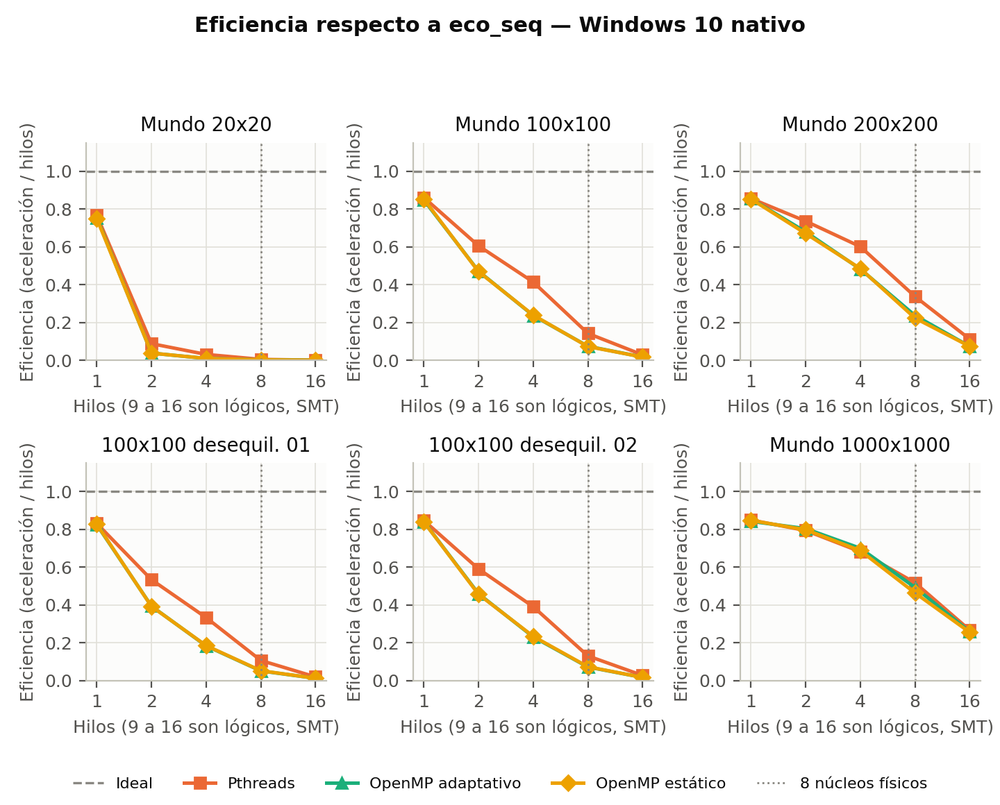

**Más hilos consumen más CPU para el mismo trabajo.** En 1000x1000 el tiempo de CPU sube de {{perf:win:large1000x1000:pth:1:cpu}} s con 1 hilo a {{perf:win:large1000x1000:pth:8:cpu}} s con 8 y {{perf:win:large1000x1000:pth:16:cpu}} s con 16, en Pthreads. El tiempo de reloj baja, pero con un coste creciente.

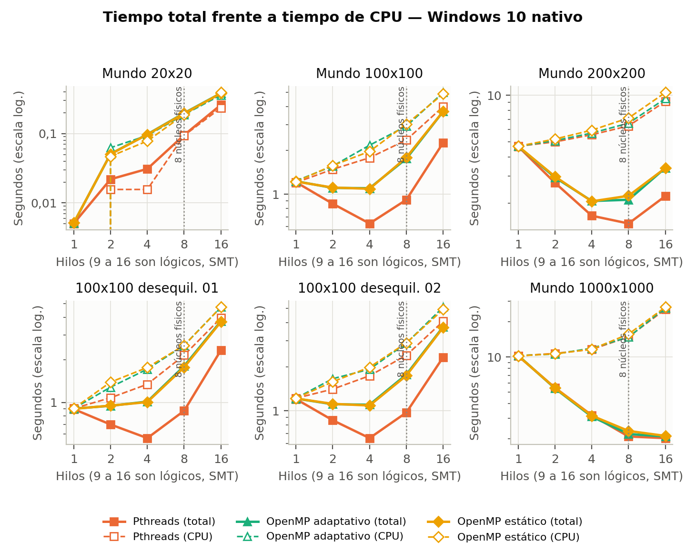

**Sobrecoste con un hilo.** Con un hilo, sin ninguna posibilidad de paralelismo, `eco_pth` y `eco_omp` son más lentos que `eco_seq`: {{overr:win:100x100:100x100_unbal01:100x100_unbal02:200x200:large1000x1000}} desde 100x100 hasta 1000x1000, y {{overr:win:20x20}} en 20x20. En 1000x1000: {{perf:win:large1000x1000:seq:1:wall}} s frente a {{perf:win:large1000x1000:pth:1:wall}} s. Es estable, no es ruido, y también aparece en el contenedor Linux ({{overr:linux}}), pero no se investigó la causa y no se afirma ninguna.

## El coste de las barreras {#barreras}

:::table barreras_tabla|1,2,2,2,2|Coste de una barrera vacía en µs (mediana de 7 repeticiones de 40 000 barreras, `experiments/barrier_bench.cpp`).
{{table:barriers}}

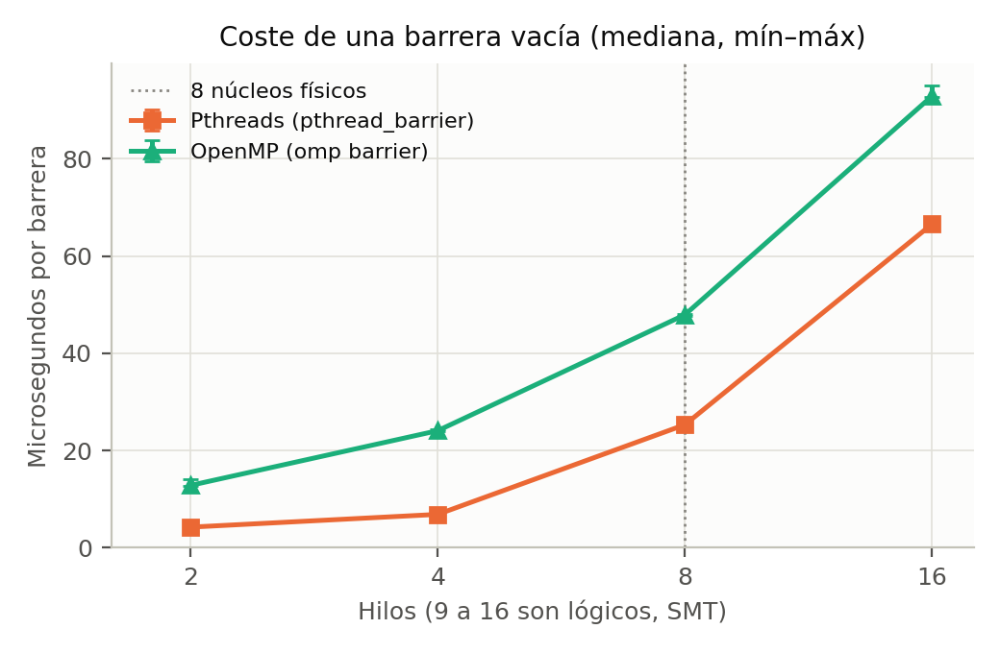

En Windows, una barrera de OpenMP cuesta más que una de Pthreads con cualquier número de hilos. Por el código, cada generación tiene 4 barreras (más 2 cada 50 generaciones en el modo adaptativo). A 16 hilos, 4 barreras vacías costarían unos {{bar4:win:pth:16}} µs en Pthreads y {{bar4:win:omp:16}} µs en OpenMP. La {{tab:grano}} las compara con el tiempo medido por generación.

:::table grano|2,2.5,3,1.5|Tiempo por generación en Windows, comparable con el coste de 4 barreras vacías a 16 hilos.
{{table:grain}}

En 20x20, 100x100 y 200x200, el tiempo por generación a 16 hilos es del mismo orden que 4 barreras, aunque el secuencial necesita mucho menos en los dos primeros. En 1000x1000 es varias veces mayor. Es coherente con que en mundos pequeños domine la sincronización y en los grandes el cálculo. Pero es una comparación de órdenes de magnitud y no una causa demostrada: el microbenchmark usa barreras vacías, y a veces da más que el tiempo medido en el programa real ({{bar4:win:pth:16}} µs frente a {{perf:win:100x100:pth:16:pergen}} µs por generación en Pthreads con 100x100).

## Reparto adaptativo frente a estático {#adaptativo}

El diseño 3 se comparó con su control estático, de modo que el modelo de hilos sea el mismo. El resultado va en contra de lo esperado:

:::table adaptativo_tabla|2.5,0.9,1.6,1.8,2.5,2.5|Desequilibrio (mayor tiempo ocupado / media) y tiempo en OpenMP, Windows. Entre corchetes, el IQR. Se muestran 8 y 16 hilos en los casos "unbal" y en 1000x1000, 8 hilos en 200x200, y las dos configuraciones de Windows donde el adaptativo no reduce el desequilibrio.
{{table:adaptive}}

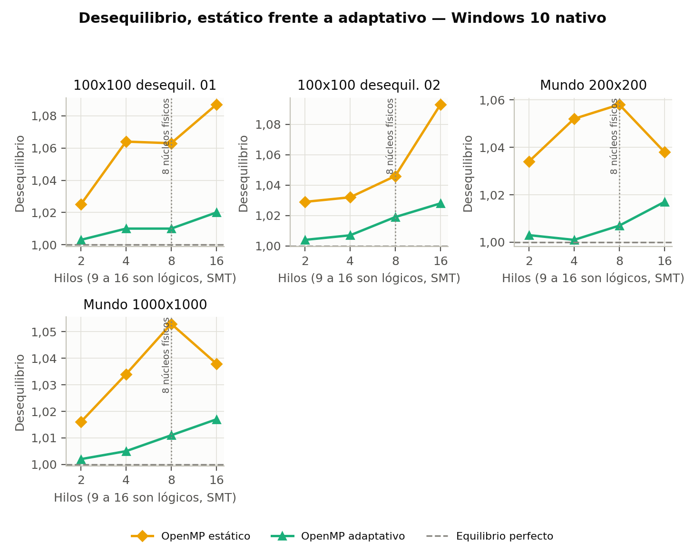

- **El adaptativo reduce el desequilibrio en casi todas las configuraciones.** Lo hace en 22 de las 24 de Windows con 2 o más hilos. Las excepciones son 20x20 con 2 y 4 hilos ({{perf:win:20x20:omp_a:2:imb}} frente a {{perf:win:20x20:omp_s:2:imb}}, y {{perf:win:20x20:omp_a:4:imb}} frente a {{perf:win:20x20:omp_s:4:imb}}). En el contenedor, de 8 configuraciones, la excepción es 1000x1000 con 4 hilos ({{perf:linux:large1000x1000:omp_a:4:imb}} frente a {{perf:linux:large1000x1000:omp_s:4:imb}}).
- **Pero no da una ganancia clara de tiempo.** En 1000x1000 con 8 hilos, {{perf:win:large1000x1000:omp_a:8:wall}} s frente a {{perf:win:large1000x1000:omp_s:8:wall}} s, una diferencia del orden del IQR. En los dos casos "unbal" es ligeramente más lento.
- **Los casos "unbal" no están muy desequilibrados en la corrida completa.** Con reparto estático su desequilibrio es de {{perf:win:100x100_unbal01:omp_s:8:imb}} y {{perf:win:100x100_unbal02:omp_s:8:imb}} a 8 hilos, de modo que hay poco que recuperar, aunque en el mundo inicial la carga sea muy desigual ({{fig:fig_cortes}}). No se midió cómo evoluciona la carga durante la corrida, y por qué se iguala queda sin probar.

No se aisló la causa de la falta de ganancia. Con estos datos, no hay ventaja de tiempo que justifique la complejidad adicional.

## Linux en un contenedor sobre WSL2 {#linux}

También se midió en un contenedor `gcc:14` (GCC {{env:linux:compiler}}) sobre Docker Desktop y WSL2, en el mismo equipo y con {{env:linux:reps}} repeticiones, solo en 200x200 y 1000x1000. **No es Linux nativo**, y estas cifras no se mezclan con las de Windows. Las banderas de compilación son las mismas, salvo el enlazado estático. El contenedor no tenía límite de CPU.

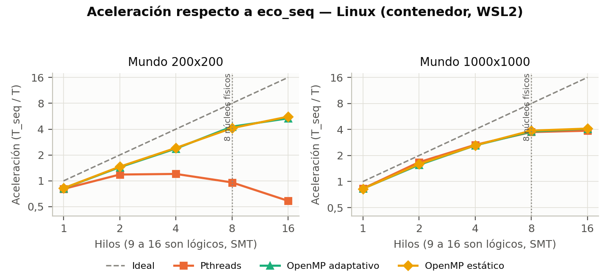

**El orden entre OpenMP y Pthreads se invierte en 200x200.** Con 16 hilos, OpenMP adaptativo tarda {{perf:linux:200x200:omp_a:16:wall}} s [{{perf:linux:200x200:omp_a:16:iqr}}] (×{{perf:linux:200x200:omp_a:16:speedup}}), el estático {{perf:linux:200x200:omp_s:16:wall}} s [{{perf:linux:200x200:omp_s:16:iqr}}] y Pthreads {{perf:linux:200x200:pth:16:wall}} s [{{perf:linux:200x200:pth:16:iqr}}] (×{{perf:linux:200x200:pth:16:speedup}}). En Windows, el mismo caso da {{perf:win:200x200:pth:16:wall}} s en Pthreads y {{perf:win:200x200:omp_a:16:wall}} s en OpenMP. En 1000x1000 el contenedor se parece a Windows: ×{{perf:linux:large1000x1000:pth:16:speedup}} en Pthreads y ×{{perf:linux:large1000x1000:omp_a:16:speedup}} en OpenMP adaptativo.

**Salvedades.** El valor de OpenMP a 16 hilos en 200x200 es muy variable: entre {{perf:linux:200x200:omp_a:16:min}} s y {{perf:linux:200x200:omp_a:16:max}} s. La mejora de 8 a 16 hilos en ese caso no aparece en 1000x1000, y no está explicada.

**La causa no está demostrada.** Las barreras en el contenedor también cambian mucho ({{tab:barreras_tabla}}): Pthreads es más caro que en Windows, lo que va en la misma dirección. El valor de OpenMP, de {{bar:linux:omp:2}} a {{bar:linux:omp:16}} µs, es tan bajo que puede reflejar la forma del microbenchmark, con barreras vacías seguidas, más que el coste con trabajo real, y por eso no se usa como causa. Entre las dos plataformas difieren el compilador, la biblioteca de OpenMP, el sistema operativo y la virtualización, y sus efectos no se separaron.

# Comparación: rendimiento, complejidad de desarrollo y mantenimiento {#comparacion}

:::table comp|2.4,4,4,4|Comparación de los tres diseños.
| Aspecto | D1: secuencial | D2: estático con Pthreads | D3: adaptativo con OpenMP |
|---|---|---|---|
| **Rendimiento en mundos pequeños** (20x20) | El mejor: {{perf:win:20x20:seq:1:wall}} s | {{perf:win:20x20:pth:2:wall}} s con 2 hilos | {{perf:win:20x20:omp_a:2:wall}} s con 2 hilos |
| **Rendimiento en mundos medianos** (200x200) | {{perf:win:200x200:seq:1:wall}} s | El mejor en Windows: {{perf:win:200x200:pth:8:wall}} s con 8 hilos | {{perf:win:200x200:omp_a:4:wall}} s con 4 hilos en Windows; el mejor en el contenedor |
| **Rendimiento en mundos grandes** (1000x1000) | {{perf:win:large1000x1000:seq:1:wall}} s | {{perf:win:large1000x1000:pth:8:wall}} s con 8 hilos | {{perf:win:large1000x1000:omp_a:8:wall}} s con 8 hilos |
| **Complejidad: código propio** | {{loc:engine/sim_seq.cpp}} líneas | {{loc:engine/sim_pth.cpp}} líneas más `engine/bands.hpp` ({{loc:engine/bands.hpp}}) | {{loc:engine/sim_omp.cpp}} líneas más `engine/bands.hpp` |
| **Complejidad: sincronización** | Ninguna | {{count:engine/sim_pth.cpp:pthread_barrier_wait}} llamadas a barrera en el código; 4 por generación | {{count:engine/sim_omp.cpp:#pragma omp barrier}} directivas de barrera en el código; 4 por generación, más 2 cada 50 |
| **Complejidad: gestión de hilos** | Ninguna | Manual: crear, unir, inicializar la barrera y reservar la memoria | La hace OpenMP: una región paralela, pero debe tratar un equipo menor que el pedido |
| **Complejidad: razonar la corrección** | Directa | Dueños fijos: basta revisar las fases | Dueños que cambian: hay que razonar además el punto de rebalanceo |
| **Complejidad: verificar carreras** | No aplica | TSan con gcc da {{tsan:pth:total}} avisos | Requiere Archer con clang: gcc da {{tsan:omp:total}} avisos, que se consideran falsos positivos |
| **Mantenimiento: cambiar una regla** | Un archivo: `engine/rules.hpp` | El mismo archivo; hay que conservar la entrega conmutativa | Igual que D2 |
| **Mantenimiento: especie nueva** | Una subfase | Una subfase, con 2 pasadas y 2 barreras más | Igual que D2, y revisar la estimación de coste |
| **Mantenimiento: riesgos** | Bajo | Errores de sincronización que no siempre cambian la salida | Lo mismo, y además un `rowOwner` desactualizado; la ganancia depende de constantes ajustadas para estos casos |
| **Mantenimiento: portabilidad del rendimiento** | Windows y contenedor: {{perf:win:200x200:seq:1:wall}} s y {{perf:linux:200x200:seq:1:wall}} s en 200x200; {{perf:win:large1000x1000:seq:1:wall}} s y {{perf:linux:large1000x1000:seq:1:wall}} s en 1000x1000 | En 200x200, mucho peor en este contenedor; en 1000x1000, parecido a Windows | En 200x200, mejor en este contenedor; en 1000x1000, algo más lento que en Windows |

:::table lineas|4,3,3|Tamaño de los archivos que distinguen a cada diseño.
{{table:loc}}

Compartir las reglas y las pasadas fue lo que más redujo el mantenimiento. Sin `engine/bands.hpp`, las pasadas se habrían copiado entre los dos diseños paralelos, y sin `engine/rules.hpp`, una corrección de una regla habría que repetirla tres veces.

**Balance.** D2 tiene la mejor relación entre rendimiento y complejidad en estos datos sobre Windows. D3 añade complejidad y no compensa con tiempo, lo cual no invalida a OpenMP, sino al rebalanceo en estos mundos: la comparación con su control estático lo muestra. D1 es el mejor mientras el mundo sea pequeño, y siempre es necesario como referencia.

# Experimentos del ecosistema {#eco}

## Qué se esperaba y qué se encontró {#eco_resumen}

> **El enunciado espera patrones cíclicos en los que zorros y conejos suben y bajan uno en relación con el otro. Esto es lo que muestran los datos:** las poblaciones sí suben y bajan de forma periódica, pero con el periodo corto de reproducción de cada especie, `GEN_PROC`+1 generaciones, y no con el ciclo lento depredador-presa esperado. Con `GEN_PROC_FOXES`=10 aparece una oscilación lenta débil, con los zorros detrás de los conejos, que no demuestra una interacción depredador-presa. En las 39 corridas de barrido no se vio ningún ciclo lento fuerte, y solo {{sens:0.3}} tienen un periodo lento débil con el umbral usado. Esto vale a la sensibilidad indicada en la {{ref:eco_limites}}: no prueba que no exista nada más lento.

Las reglas no se ajustaron para obtener ciclos: están fijadas por las salidas esperadas de la tarea, y la configuración base se eligió antes de los barridos y no se cambió después.

## Método {#eco_metodo}

- **Corridas.** Mundo 100x100 con `eco_seq` y `--stats-file`, 10 000 generaciones, semillas 1, 2 y 3, que fijan las posiciones iniciales.
- **Base.** 1500 conejos, 150 zorros y 500 rocas (5 %), `GEN_PROC_RABBITS`=3, `GEN_PROC_FOXES`=20 y `GEN_FOOD_FOXES`=10, los valores de los ejemplos de la tarea. Se eligió una sola vez, tras explorar 10 combinaciones iniciales, en todas las cuales coexistieron las dos especies.
- **Barridos.** Un parámetro cada vez desde la base, con valores fijados de antemano: 13 configuraciones por 3 semillas, 39 corridas. Se añadieron 6 corridas largas de 20 000 generaciones, de la base y de `GEN_PROC_FOXES`=10, después de ver una señal débil en esta última.
- **Análisis** (`experiments/ecosystem_runs.py`). Se descarta el primer 20 % y la tendencia lineal. El periodo rápido es el primer pico de autocorrelación >= 0,3 de la serie cruda. Ese patrón se resta exactamente, restando a cada generación la media de su fase módulo el mínimo común múltiplo de los periodos rápidos (el *fold*: 84 en la base). En lo que queda se busca un periodo lento: **débil** si el pico de autocorrelación es >= 0,3, y **fuerte** si además llega a 0,6 con amplitud de al menos 10 % de la media.

Los datos de cada corrida están en `experiments/results/ecosystem`, y `ecosystem_findings.md` tiene el detalle.

## Oscilación rápida {#eco_rapida}

Los periodos de la serie cruda son iguales en las 3 semillas: `GEN_PROC_RABBITS`+1 en conejos (3, 4 o 6) y `GEN_PROC_FOXES`+1 en zorros (11, 21 o 41). Es una oscilación grande: en la base, entre las generaciones 2000 y 2100, los conejos van de {{ser:base:1:rabbits:win:2000:2100}} y los zorros hacen dientes de sierra de {{ser:base:1:foxes:win:2000:2100}} ({{fig:fig_eco_base}}). El coeficiente de variación de la serie cruda es de {{ser:base:1:rabbits:rawcv}} en conejos y {{ser:base:1:foxes:rawcv}} en zorros. La coincidencia con `GEN_PROC`+1 es lo observado; el mecanismo no se verificó, ni se demostró que esta oscilación sea una interacción depredador-presa.

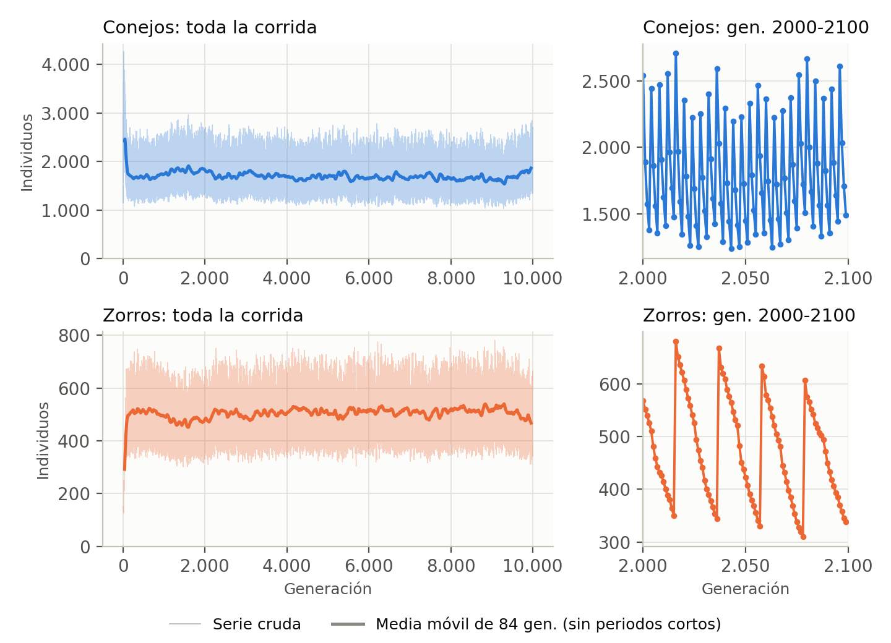

## Un solo sobreimpulso inicial {#eco_trans}

Al empezar, la población hace un único sobreimpulso amortiguado, no un ciclo que se repita ({{fig:fig_eco_trans}}). En la base (semilla 1), los conejos suben de 1500 a un máximo de {{ser:base:1:rabbits:max}} en la generación {{ser:base:1:rabbits:argmax}}, mientras los zorros bajan a {{ser:base:1:foxes:at:20}}. Hacia la generación 110 los zorros han subido a unos {{ser:base:1:foxes:ma:110}} y los conejos han bajado a unos {{ser:base:1:rabbits:ma:110}} (medias móviles de 21 generaciones). Hay un rebote pequeño ({{ser:base:1:rabbits:ma:210}} en la 210 y {{ser:base:1:rabbits:ma:310}} en la 310), y luego se estabilizan ({{ser:base:1:rabbits:ma:1010}} en la 1010).

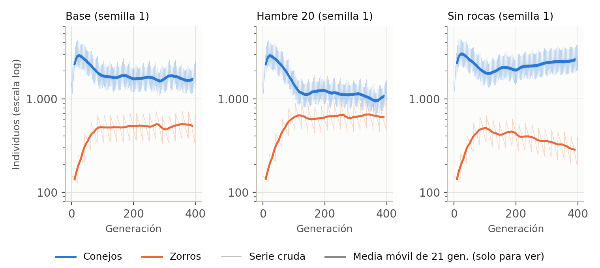

## Oscilación lenta débil con `GEN_PROC_FOXES`=10 {#eco_debil}

:::table debil|2.6,1.2,1.2,2.1,2.1,1.1,1.1|Periodos lentos con `GEN_PROC_FOXES`=10, cuyo *fold* es 44. Pares conejos / zorros. El desfase positivo significa que los zorros van detrás.
{{table:eco_weak}}

Con umbral 0,3 se detecta en 5 de las 6 corridas. La semilla 3 de 10 000 generaciones queda por debajo del umbral; con 0,2 da periodos de {{sensp:0.2:gpf:10:3:rabbit_period}} y {{sensp:0.2:gpf:10:3:fox_period}} y desfase de {{sensp:0.2:gpf:10:3:fox_lag}}. En las 6, los zorros van 22 a 23 generaciones detrás de los conejos, con correlación cruzada de {{eco:long_gpf10:3:fox_lag_corr}} a {{eco:long_gpf10:2:fox_lag_corr}}, y amplitud de 5 a 9 % de la media.

**Esto no demuestra una interacción depredador-presa.** Es débil, y los periodos hallados están cerca de múltiplos de los periodos rápidos 4 y 11 (76 = 19 × 4, 77 = 7 × 11), de modo que no se descarta un batido entre los dos temporizadores de reproducción. No se probó.

## Efecto de los parámetros en la estabilidad {#eco_param}

:::table barrido|2.8,1.3,1.5,1.3,2.6,2.5|Resultado de los barridos, con el rango de las 3 semillas. `slowcv` es la variación lenta: desviación entre media de la segunda mitad sin patrón rápido ni tendencia. Generación de extinción en cada semilla.
{{table:eco_sweep}}

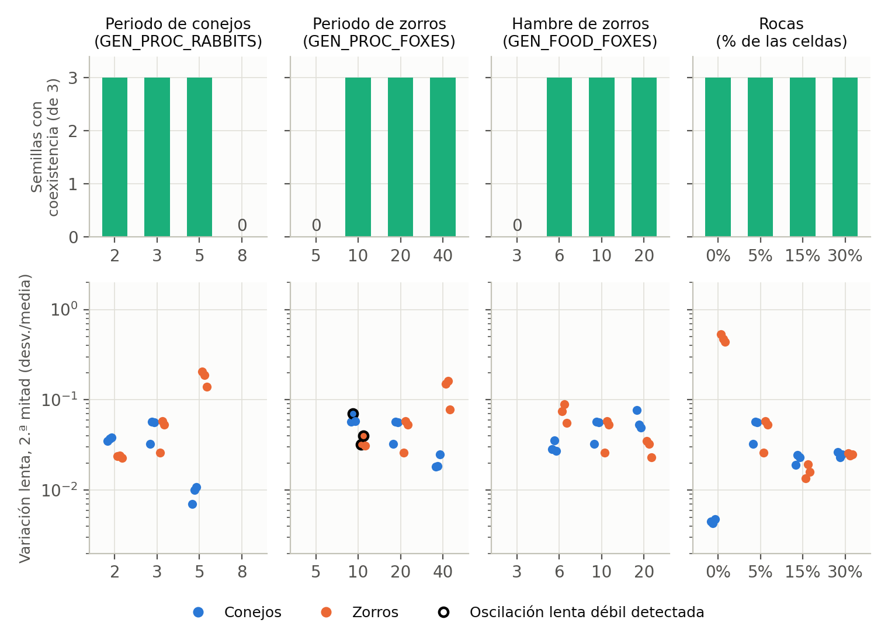

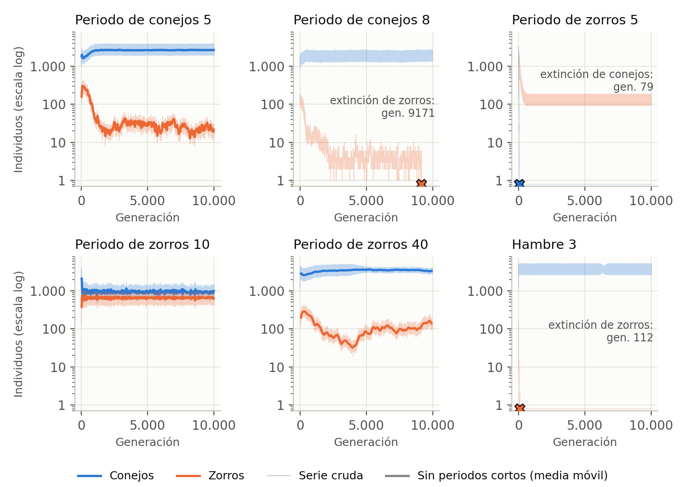

Estas son **asociaciones; no se probó causalidad**:

- **`GEN_PROC_RABBITS`.** Los zorros bajan de un rango de {{ecorh:gpr2:fox_mean}} con 2 a {{ecorh:gpr5:fox_mean}} con 5. Con 8 se extinguen, en las generaciones {{eco:gpr8:1:extinct_foxes_gen}}, {{eco:gpr8:2:extinct_foxes_gen}} y {{eco:gpr8:3:extinct_foxes_gen}} según la semilla.
- **`GEN_PROC_FOXES`.** Con 5 se extinguen los conejos, en las generaciones {{eco:gpf5:1:extinct_rabbits_gen}}, {{eco:gpf5:2:extinct_rabbits_gen}} y {{eco:gpf5:3:extinct_rabbits_gen}}, y sobreviven los zorros. Una prueba aparte, sin conejos, también deja zorros con ese valor ({{fox:5:foxes_gen2999}} en la generación 2999), mientras que con 10 se extinguen en la generación {{fox:10:extinct_foxes_gen}}. La causa no se probó. Con 10 hay más zorros ({{ecor:gpf10:fox_mean}}) y menos conejos ({{ecor:gpf10:rabbit_mean}}).
- **`GEN_FOOD_FOXES`.** Con 3 los zorros se extinguen en las generaciones {{eco:gff3:1:extinct_foxes_gen}}, {{eco:gff3:2:extinct_foxes_gen}} y {{eco:gff3:3:extinct_foxes_gen}}. Los zorros suben de un rango de {{ecorh:gff6:fox_mean}} con 6 a {{ecorh:gff20:fox_mean}} con 20, y los conejos bajan.
- **Derivas largas.** "Estable" no significa "constante". Por ejemplo, con `GEN_PROC_RABBITS`=5 (semilla 1) los zorros pasan de unos {{ser:gpr5:1:foxes:ma:150}} en la generación 150 a unos {{ser:gpr5:1:foxes:ma:1510}} en la 1510.

## Efecto de las rocas {#eco_rocas}

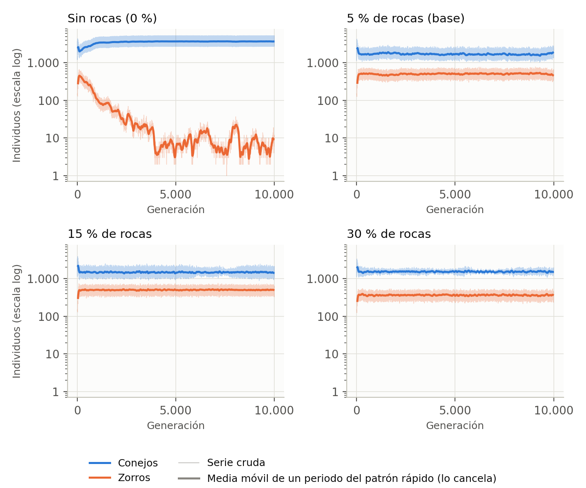

- **Sin rocas**, los zorros suben a unos {{ser:rocks0:1:foxes:ma:105}} hacia la generación 105 y luego declinan durante miles de generaciones ({{ser:rocks0:1:foxes:ma:1010}} en la 1010 y {{ser:rocks0:1:foxes:ma:3010}} en la 3010). Quedan con una media de {{ecor:rocks0:fox_mean}}, con altibajos irregulares: no se extinguen en 10 000 generaciones, pero quedan cerca de 0.
- **Con rocas**, los zorros se sostienen: {{ecor:base:fox_mean}} con 5 %, {{ecor:rocks1500:fox_mean}} con 15 % y {{ecor:rocks3000:fox_mean}} con 30 %. La variación lenta de los zorros es la más baja con 15 % ({{ecor:rocks1500:fox_slowcv}}, frente a {{ecor:base:fox_slowcv}} con 5 %).
- **Son asociaciones.** El enunciado describe las rocas como refugio, pero que actúen como refugio de los conejos o que rompan la sincronía espacial es una hipótesis no probada: no se midió la distribución espacial.

## Qué detecta el análisis, y qué no {#eco_limites}

Para saber qué se habría visto, se inyectaron ciclos conocidos en series reales de 4 configuraciones y 3 semillas: se multiplicó la serie por (1 + a sen(2π g / P)) y se contó cuántas veces el análisis encontró un periodo a menos del 15 % de P.

:::table inyeccion|2,2,2,2,2|Detección de ciclos inyectados (`experiments/results/ecosystem_injection.csv`).
{{table:eco_injection}}

- **Sensibilidad.** Con amplitud de al menos 10 % de la media se detectan casi todos entre 40 y 2000 generaciones, salvo el periodo 84. Un ciclo de 5 % o menos puede pasar inadvertido.
- **Hay un punto ciego en el fold.** Un ciclo cuyo periodo coincide con el *fold* (84 en tres de las cuatro configuraciones) se resta junto con el patrón: hasta 10 % de amplitud solo se detectó donde el *fold* era otro, y con 20 %, en 5 de las 9 series con *fold* 84. En particular, en la serie cruda de la base larga hay un pico de autocorrelación en 84 ({{acf:84}}), pero 84 es el mínimo común múltiplo de 4 y 21, así que ese pico es el que produce el patrón rápido. Cualquier señal real cerca de 84-85 no se puede distinguir de esa banda. La rejilla de inyección tampoco tiene otros periodos entre 60 y 100.
- **Umbral.** De las 39 corridas de barrido, {{sens:0.5}} tienen periodo lento con umbral 0,5, {{sens:0.3}} con 0,3, {{sens:0.2}} con 0,2 y {{sens:0.1}} con 0,1. Con 0,1 los periodos van de unos 76 a 2600 generaciones, con desfases de signo cambiante, lo que parece ruido.
- **Falsos positivos.** En 150 series de ruido rojo (AR(1), phi 0,99) se halló un ciclo falso en 6 con 6000 generaciones y en 0 con 10 000.
- **Sin probar.** Otros tamaños de mundo, otras densidades iniciales, corridas de más de 20 000 generaciones y periodos menores que 40. Tampoco se probaron las causas de la oscilación rápida, de la débil, de las derivas ni del efecto de las rocas.

# Interfaz visual {#interfaz}

La interfaz es una página web local en tres columnas: parámetros a la izquierda, grilla al centro con los controles de tiempo debajo, y estadísticas a la derecha. Funciona sin internet, con Python y su biblioteca estándar en el servidor y HTML, CSS y JavaScript sin dependencias externas en el navegador.

El servidor (`web/server.py`) lanza el motor como proceso aparte con `--frames`. Cada cuadro tiene una cabecera de 16 bytes y 1 byte por celda. El motor se bloquea cuando nadie lee, así que una página en pausa no acumula memoria, y una corrida larga no se genera por adelantado. Por omisión usa `eco_seq`. Las mediciones de la {{ref:rendimiento}} no pasan por la interfaz.

:::table visuales|4,8|Los cuatro requisitos visuales del enunciado.
| Requisito | Cómo se cumple |
|---|---|
| Grilla con todas las entidades | Canvas central, con color distinto para conejo, zorro y roca, y con leyenda. Desde 8 píxeles por celda usa también formas. Por debajo, solo el color los distingue. |
| Estadísticas de población en el tiempo | Contadores de conejos, zorros y rocas, generación actual y gráfica de población. La gráfica dibuja una banda de mínimo y máximo con la media, para que el patrón rápido no la vuelva una mancha. |
| Parámetros ajustables | Poblaciones iniciales, tamaño y semilla en el mundo aleatorio; `GEN_PROC_RABBITS`, `GEN_PROC_FOXES`, `GEN_FOOD_FOXES` y `N_GEN` también en los casos de prueba. Cada uno lleva su nombre en lenguaje claro y su nombre técnico. |
| Controles de tiempo | Pausa y reanudar, también con la barra espaciadora; "Más lento" y "Más rápido", de 1 a 500 generaciones por segundo; y barra de progreso. |

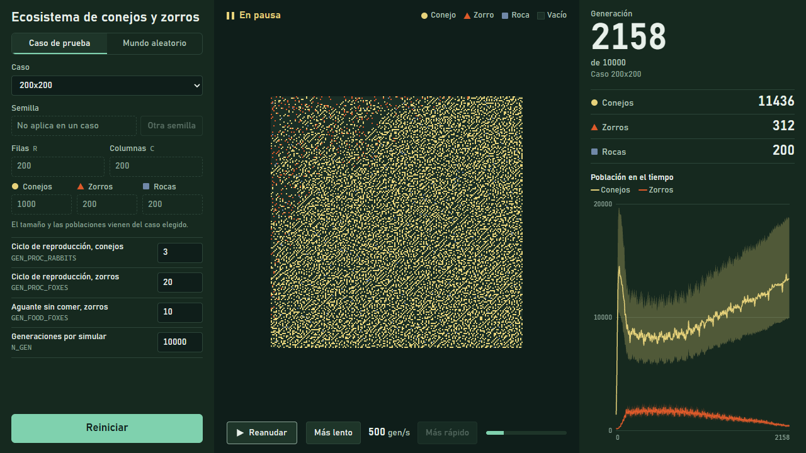

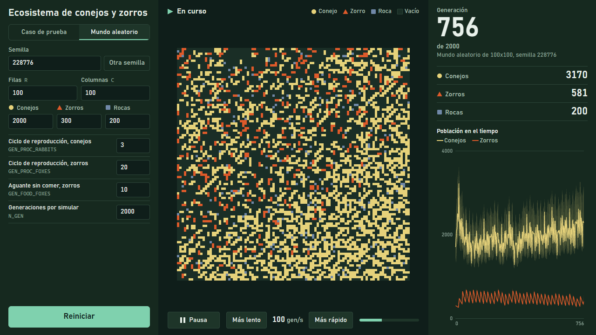

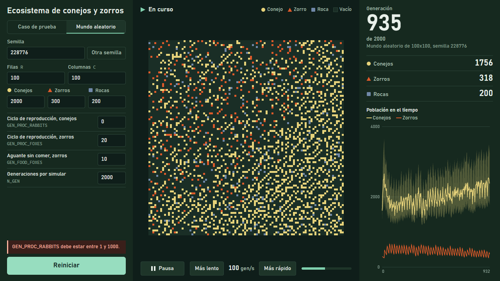

La interfaz se revisó en Chromium: un caso de 5x5 hasta el final, con conteos iguales a la salida esperada; 200x200 a 500 generaciones por segundo hasta la generación 10 000, sin errores en la página; pausa, velocidades, reinicio, parámetros inválidos y motor sin compilar. El límite es de 500 filas y 500 columnas. El código de la página no tiene pruebas automáticas; sí las tiene el servidor (`tests/test_server.py`).

# Cómo ejecutar el programa {#ejecutar}

Requisitos: g++ con OpenMP y Pthreads (se usó WinLibs GCC {{env:win:compiler}}), CMake y Ninja, y Python 3.12. El script de compilación fija la ruta de WinLibs de este equipo, de modo que en otro hay que ajustarla.

```
# Compilar en Windows (deja eco_seq, eco_pth y eco_omp en build/)
powershell scripts/build.ps1

# Compilar en Linux
cmake -S . -B build -DCMAKE_BUILD_TYPE=Release -DECO_STATIC=OFF && cmake --build build

# Ejecutar cada diseño: entrada por stdin, resultado por stdout, tiempos por stderr.
# Comandos para bash (Git Bash en Windows). En Linux, sin .exe. En PowerShell, "<" no existe:
#   cmd /c "build\eco_seq.exe < ecosystem_examples\input100x100"
build/eco_seq.exe < ecosystem_examples/input100x100
build/eco_pth.exe --threads 8 < ecosystem_examples/input100x100
build/eco_omp.exe --threads 8 < ecosystem_examples/input100x100
build/eco_omp.exe --threads 8 --schedule static < ecosystem_examples/input100x100

# Interfaz: abrir http://127.0.0.1:8000 en el navegador
python web/server.py --port 8000

# Pruebas
python -m unittest discover -s tests -t .

# Repetir las mediciones y los experimentos
python experiments/measure.py run
python experiments/ecosystem_runs.py run

# Regenerar este informe
python docs/report/build_report.py
```

La línea de tiempos en stderr tiene esta forma: `time wall=... cpu=... threads=... imbalance=...`. Otras opciones del motor: `--dump-all`, que escribe todas las generaciones en el formato `allgen`; `--frames`, que emite cuadros para la interfaz; y `--stats-file RUTA`, que guarda la población por generación.

# Conclusión {#conclusion}

La reflexión del curso dice que un diseño paralelo no siempre necesita más hilos para ser más rápido. Estos datos lo confirman de forma concreta. Con los mismos 16 hilos, Pthreads tarda {{perf:win:20x20:pth:16:wall}} s en 20x20, frente a {{perf:win:20x20:seq:1:wall}} s del secuencial, y en 1000x1000 acelera ×{{perf:win:large1000x1000:pth:16:speedup}}. Esto es coherente con que importe cuánto trabajo hay entre dos puntos de sincronización, aunque no se midió un desglose que lo demuestre ({{ref:barreras}}).

Tres conclusiones van más allá de lo que se esperaba al empezar:

1. **La complejidad no compró tiempo.** El reparto adaptativo baja el desequilibrio en casi todas las configuraciones, pero sin una ganancia clara de tiempo. El desequilibrio estático ya era pequeño, y no se aisló la causa.
2. **La plataforma también importa.** En 200x200, en este contenedor, la misma fuente invierte la comparación entre OpenMP y Pthreads. En 1000x1000 el contenedor se parece a Windows, y OpenMP adaptativo es más lento allí ({{perf:linux:large1000x1000:omp_a:16:wall}} s frente a {{perf:win:large1000x1000:omp_a:16:wall}} s con 16 hilos). Una elección de modelo basada en una sola plataforma y un solo tamaño no se puede generalizar.
3. **Separar decisión y entrega fue lo más valioso.** Decidir sobre un estado de solo lectura y entregar de forma conmutativa dio el mismo resultado en todos los casos y números de hilos, con una sincronización simple y sin candados.

:::table recomendacion|2.2,3.4,6.4|Recomendación según el tamaño del mundo, con los datos de Windows de la {{tab:mejores}}.
| Mundo | Diseño recomendado | Por qué |
|---|---|---|
| Pequeño (20x20; no se midió ningún tamaño entre este y 100x100) | D1, secuencial | Cualquier diseño paralelo es más lento: {{perf:win:20x20:seq:1:wall}} s frente a {{perf:win:20x20:pth:2:wall}} s con Pthreads y 2 hilos. |
| Mediano (100x100) | D2 con 4 hilos | Único con ganancia: ×{{perf:win:100x100:pth:4:speedup}}. Con 2 a 4 hilos basta, y con 16 es peor que el secuencial. OpenMP no pasa de ×{{perf:win:100x100:omp_s:4:speedup}}. |
| Mediano-grande (200x200) | D2 con 8 hilos | ×{{perf:win:200x200:pth:8:speedup}}. Con 16 hilos baja a ×{{perf:win:200x200:pth:16:speedup}}. |
| Grande (1000x1000) | D2 o D3 con 8 hilos | ×{{perf:win:large1000x1000:pth:8:speedup}} y ×{{perf:win:large1000x1000:omp_a:8:speedup}}. Pasar a 16 hilos casi no mejora el tiempo y sube la CPU de {{perf:win:large1000x1000:pth:8:cpu}} s a {{perf:win:large1000x1000:pth:16:cpu}} s. |

Estas recomendaciones valen para este equipo y este sistema. En el contenedor Linux, en 200x200, la recomendación sería OpenMP (×{{perf:linux:200x200:omp_a:8:speedup}} con 8 hilos, frente a ×{{perf:linux:200x200:pth:8:speedup}} de Pthreads). Por eso, antes de elegir, conviene medir en la plataforma final. No se recomienda el rebalanceo por su tiempo: su control estático rinde de forma parecida en estos casos, con menos código.

En cuanto al ecosistema, la simulación muestra cómo los parámetros cambian la estabilidad, desde la coexistencia hasta la extinción de una especie, y sus poblaciones oscilan. Pero no muestra, a la sensibilidad indicada, el ciclo lento y fuerte entre depredador y presa que esperaba el enunciado, y este informe lo deja dicho en lugar de forzarlo.

# Apéndice: tablas completas de tiempos {#tablas}

Cada celda tiene la mediana del tiempo total en segundos, el IQR entre corchetes, la aceleración respecto a `eco_seq` (×) y la eficiencia (e). La última columna es el sobrecoste con 1 hilo frente a `eco_seq`. El tiempo de CPU de cada medición está en `experiments/results/performance.csv`, y aparece en la {{fig:fig_cpu}}.

## Windows 10 nativo

:::table w20|2.2,1.75,1.75,1.75,1.75,1.75,1.1|20x20: `eco_seq` {{perf:win:20x20:seq:1:wall}} s [{{perf:win:20x20:seq:1:iqr}}], {{ngen:20x20}} generaciones. El CPU medido aquí no es fiable, por su resolución.
{{table:perf:win:20x20}}

:::table w100|2.2,1.75,1.75,1.75,1.75,1.75,1.1|100x100: `eco_seq` {{perf:win:100x100:seq:1:wall}} s [{{perf:win:100x100:seq:1:iqr}}], {{ngen:100x100}} generaciones.
{{table:perf:win:100x100}}

:::table wu1|2.2,1.75,1.75,1.75,1.75,1.75,1.1|100x100 `unbal01`: `eco_seq` {{perf:win:100x100_unbal01:seq:1:wall}} s [{{perf:win:100x100_unbal01:seq:1:iqr}}], {{ngen:100x100_unbal01}} generaciones.
{{table:perf:win:100x100_unbal01}}

:::table wu2|2.2,1.75,1.75,1.75,1.75,1.75,1.1|100x100 `unbal02`: `eco_seq` {{perf:win:100x100_unbal02:seq:1:wall}} s [{{perf:win:100x100_unbal02:seq:1:iqr}}], {{ngen:100x100_unbal02}} generaciones.
{{table:perf:win:100x100_unbal02}}

:::table w200|2.2,1.75,1.75,1.75,1.75,1.75,1.1|200x200: `eco_seq` {{perf:win:200x200:seq:1:wall}} s [{{perf:win:200x200:seq:1:iqr}}], {{ngen:200x200}} generaciones.
{{table:perf:win:200x200}}

:::table w1000|2.2,1.75,1.75,1.75,1.75,1.75,1.1|1000x1000: `eco_seq` {{perf:win:large1000x1000:seq:1:wall}} s [{{perf:win:large1000x1000:seq:1:iqr}}], {{ngen:large1000x1000}} generaciones.
{{table:perf:win:large1000x1000}}

## Linux en un contenedor sobre WSL2

:::table l200|2.2,1.75,1.75,1.75,1.75,1.75,1.1|200x200: `eco_seq` {{perf:linux:200x200:seq:1:wall}} s [{{perf:linux:200x200:seq:1:iqr}}], kernel {{env:linux:kernel}}.
{{table:perf:linux:200x200}}

:::table l1000|2.2,1.75,1.75,1.75,1.75,1.75,1.1|1000x1000: `eco_seq` {{perf:linux:large1000x1000:seq:1:wall}} s [{{perf:linux:large1000x1000:seq:1:iqr}}].
{{table:perf:linux:large1000x1000}}
